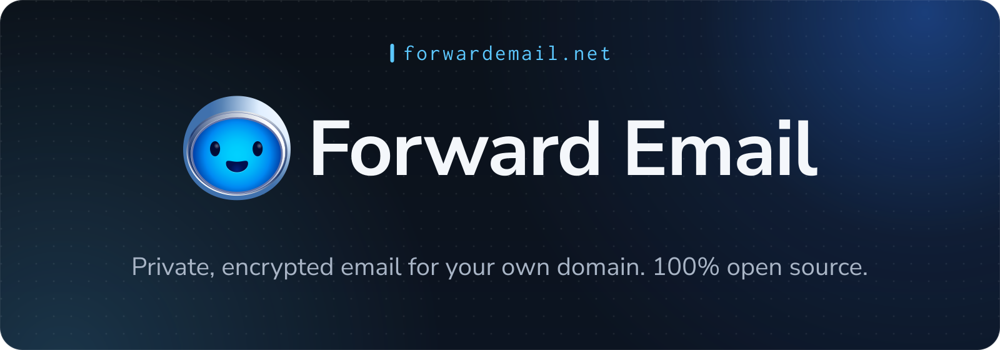
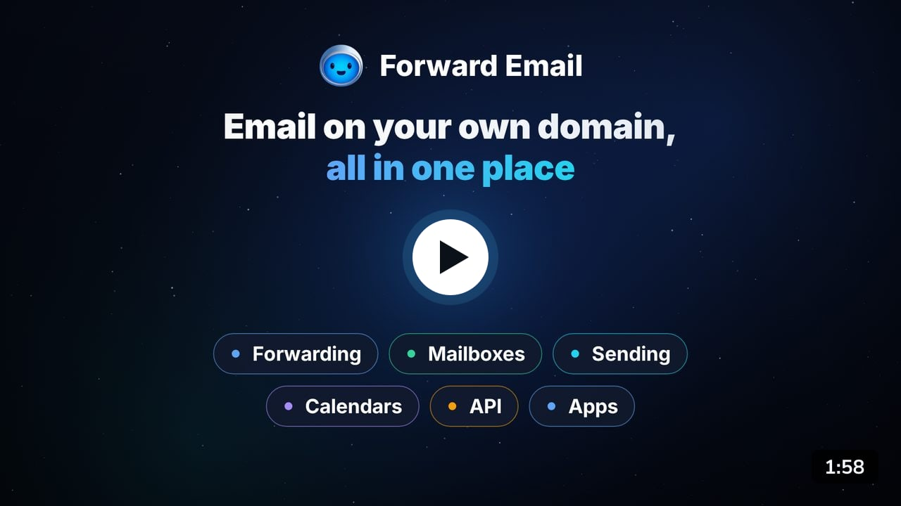

<h1 align="center">
  
</h1>

  <a href="https://forwardemail.net/register"><strong>Start free</strong></a>
  &nbsp;·&nbsp;
  <a href="https://forwardemail.net/#video">Watch the tour</a>
  &nbsp;·&nbsp;
  <a href="https://forwardemail.net/private-business-email">Pricing</a>
  &nbsp;·&nbsp;
  <a href="https://forwardemail.net/download">Apps</a>
  &nbsp;·&nbsp;
  <a href="https://forwardemail.net/faq">FAQ</a>
  &nbsp;·&nbsp;
  <a href="https://forwardemail.net/email-api">API</a>
  &nbsp;·&nbsp;
  <a href="https://forwardemail.net/self-hosted">Self-host</a>
  &nbsp;·&nbsp;
  <a href="https://status.forwardemail.net">Status</a>

We build **[Forward Email](https://forwardemail.net)**, a 100% open-source, privacy-focused email service for custom domains. You get `you@yourdomain.com` with forwarding, encrypted mailboxes, sending, calendars, contacts, and an email API in one place. Forwarding to Gmail, Outlook, iCloud, or any inbox is free, and paid plans start at $3/month.

More than 1.6 million domains use Forward Email, including The Linux Foundation, Ubuntu, the University of Cambridge, Disney Ad Sales, and the US Naval Academy.

### 🎬 Watch the 2-minute tour

### 👋 Start here

| I want to…                                         | Go here                                                                                             |
| -------------------------------------------------- | --------------------------------------------------------------------------------------------------- |
| Get email at my own domain                         | [Create a free account](https://forwardemail.net/register)                                          |
| Forward my domain's mail to Gmail, Outlook, iCloud | [Step-by-step setup](https://forwardemail.net/faq#how-do-i-get-started-and-set-up-email-forwarding) |
| Read my mail in an app                             | [Download the apps](https://forwardemail.net/download)                                              |
| Send email from my app or website                  | [Email API](https://forwardemail.net/email-api)                                                     |
| Run it on my own server                            | [Self-hosting guide](https://forwardemail.net/self-hosted)                                          |
| Read the code                                      | [forwardemail.net](https://github.com/forwardemail/forwardemail.net)                                |

### 🔐 Why people switch

* **Private by design.** We process forwarded mail in memory and never write it to disk. Each mailbox is its own encrypted SQLite file that only your password can open.
* **100% open source.** The website, the API, every mail server, and every app live in public repositories, so anyone can check our privacy claims.
* **Works everywhere.** Use Apple Mail, Gmail, Outlook, Thunderbird, or [our own apps](https://github.com/forwardemail/mail.forwardemail.net) over IMAP, POP3, SMTP, CalDAV, and CardDAV.
* **No per-user fees.** Every plan includes unlimited domains, and paid plans include unlimited aliases.

### 📦 Our repositories

| Repository                                                                                         | What it is                                                         |
| -------------------------------------------------------------------------------------------------- | ------------------------------------------------------------------ |
| [forwardemail.net](https://github.com/forwardemail/forwardemail.net)                               | The email service: website, API, and every mail server             |
| [mail.forwardemail.net](https://github.com/forwardemail/mail.forwardemail.net)                     | Webmail, plus desktop, mobile, and terminal apps                   |
| [mcp-server](https://github.com/forwardemail/mcp-server)                                           | MCP server that connects AI assistants to your account             |
| [terraform-provider-forwardemail](https://github.com/forwardemail/terraform-provider-forwardemail) | Manage domains and aliases with Terraform                          |
| [forwardemail-api-go](https://github.com/forwardemail/forwardemail-api-go)                         | Go client for the API                                              |
| [status.forwardemail.net](https://github.com/forwardemail/status.forwardemail.net)                 | Status page                                                        |
| [awesome-mail-server-providers](https://github.com/forwardemail/awesome-mail-server-providers)     | Comparison of server providers for hosting mail servers            |

### 🧰 Open-source libraries we maintain

* [superagent](https://github.com/forwardemail/superagent) and [supertest](https://github.com/forwardemail/supertest): HTTP client and HTTP server testing for Node.js
* [email-templates](https://github.com/forwardemail/email-templates) and [preview-email](https://github.com/forwardemail/preview-email): create, preview, and send email from Node.js
* [tangerine](https://github.com/forwardemail/tangerine): DNS over HTTPS resolver for Node.js
* [caldav-adapter](https://github.com/forwardemail/caldav-adapter): CalDAV server for Node.js and Koa
* [reserved-email-addresses-list](https://github.com/forwardemail/reserved-email-addresses-list): usernames to reserve for security
* Sister projects: [Spam Scanner](https://github.com/spamscanner) (spam filter), [Bree](https://github.com/breejs) (job scheduler), [Cabin](https://github.com/cabinjs) (logging), and [Lad](https://github.com/ladjs) (web framework)

### 💬 Get in touch

* **Questions:** [FAQ](https://forwardemail.net/faq) or [GitHub Discussions](https://github.com/forwardemail/forwardemail.net/discussions)
* **Support:** [support@forwardemail.net](mailto:support@forwardemail.net)
* **Security reports:** [security@forwardemail.net](mailto:security@forwardemail.net) (see our [security policy](https://github.com/forwardemail/.github/blob/main/SECURITY.md))
* **Follow us:** [X](https://x.com/fwdemail), [Matrix](https://matrix.to/#/#forwardemail:matrix.org), and [YouTube](https://youtube.com/forwardemail)

<a href="https://forwardemail.net/register"><strong>Get started free at forwardemail.net →</strong></a>

